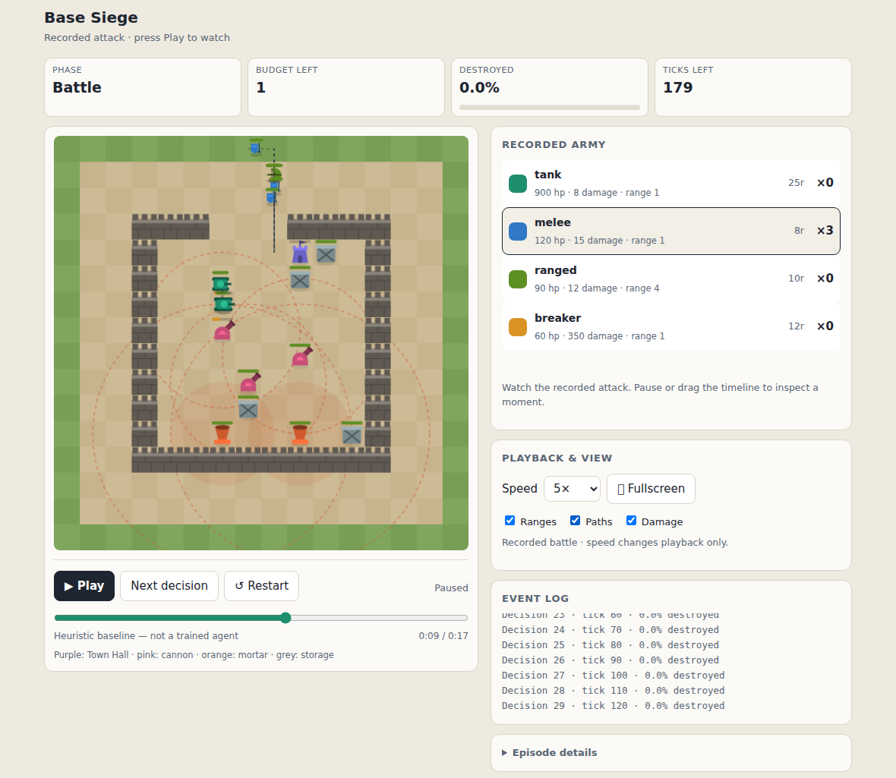

# Base Siege

**A reinforcement learning commander for army purchasing and troop deployment in a custom base-attack simulator.**

University of Technology Sydney · 43008 Reinforcement Learning · Assignment 3 · Project 12 · Team Dihedrals

Base Siege asks a learning agent to assemble an army within a fixed budget and deploy it against a defended base. Troop movement, target selection and defensive combat follow programmed rules. The agent learns the purchasing and deployment strategy through interaction with the simulator.

The project compares **MaskablePPO without symmetry augmentation (P)** with **the same learner trained using rotated and reflected coordinate views (PA)**. The latest Version 2 evaluation covers twenty independent models trained to **4,194,304 transitions each**. Using deterministic purchasing and sampled deployment (DS), P achieved **92.96% mean destruction** and PA achieved **93.53%**, compared with **56.90%** for the heuristic baseline.

**Updated 1 October 2026.** This README separates the original short-budget study from the later Version 2 study. The original directory name `runs/study-v2/` belongs to the earlier 262,144-transition study; it is not the latest Version 2 model cohort.

This is a custom educational simulator inspired by base-attack strategy games. It is not connected to the commercial Clash of Clans game.

## Application preview



*Recorded interface screenshot showing the heuristic baseline. This image illustrates the replay controls, not a trained PPO result.*

The application supports:

- **Manual play:** purchase an army and deploy troops using browser combat controls.
- **Policy replay:** watch a heuristic, random policy or saved MaskablePPO model.
- **Base editor:** create compatible custom layouts for manual play or agent demonstrations.
- **Saved replay:** inspect a previously recorded attack.
- **Experiment results:** browse saved training manifests and evaluation tables.

Manual combat runs in the browser for smoother interaction. Trained-agent replays are generated from Python simulator trajectories. Playback speed changes the animation, not the recorded battle outcome.

## Quick start

### Requirements

- **Python 3.12**; the recorded training environment used **3.12.14**.
- **uv** for installing the dependencies in `uv.lock`.
- **Git and Git LFS** for downloading code, models and recovery data.
- Linux or macOS. On Windows, use **WSL2 with Ubuntu** for the complete research workflow because recovery modules use Unix file locking.
- Internet access for the initial dependency installation and model download.

The local application loads saved policies on the **CPU**. A training GPU is not required for replay or manual play. The complete experiment folders occupy several gigabytes, and dependency installation requires additional space.

### 1. Clone the repository and retrieve large files

Open a terminal on your computer, or the Ubuntu terminal on Windows. Install Git LFS first if `git lfs version` is unavailable. On Ubuntu:

```bash
sudo apt-get update
sudo apt-get install -y git-lfs
```

Then run:

```bash
git lfs install
git clone https://github.com/vaibhavbai1/base-siege.git
cd base-siege
git lfs pull
```

For a private repository, your GitHub account must have access and Git authentication must be configured. If you already cloned the repository, enter its folder and run `git lfs pull` instead of cloning again.

**Use Git LFS when retrieving saved models.** An unresolved LFS pointer is a small text file, not a usable model or database. The repository's `.gitattributes` defines which files use LFS. Model and results availability depends on the experiment-data upload having completed; if a required path is absent after pulling, obtain the corresponding experiment bundle from the project owner. Retraining is not required to recover an existing model file.

### 2. Install dependencies

Run these commands from the repository root, where `pyproject.toml` and `uv.lock` are located:

```bash
uv python install 3.12.14
uv sync --frozen --python 3.12.14
```

If uv is not installed, one option is to install it in a separate tools environment:

```bash
python3 -m venv "$HOME/.venvs/base-siege-tools"
"$HOME/.venvs/base-siege-tools/bin/python" -m pip install uv
export PATH="$HOME/.venvs/base-siege-tools/bin:$PATH"
```

Then repeat the installation commands above. On Ubuntu, a missing `venv` module can be installed with `sudo apt-get install python3-venv`. Repeat the PATH export in a new terminal if required.

`--frozen` uses the existing lock file without changing dependency choices. Keep the recorded versions when reproducing the study. A package-installation failure should be diagnosed before changing version pins.

### 3. Launch the local application

```bash
uv run --frozen streamlit run ui/app.py --server.address 127.0.0.1 --server.port 8512
```

Open **http://127.0.0.1:8512** in your browser. Keep the terminal running; press **Ctrl+C** there to stop the server.

Use **`ui/app.py`** for the complete local project. `ui/streamlit_app.py` enables the separate public-demo mode, which looks for selected exports in `demo_assets/` rather than the full research run folders.

These localhost instructions are for a local computer or WSL. If you launch the app on SageMaker, use the application/port access mechanism provided by your SageMaker workspace; your computer's localhost URL does not refer to the remote SageMaker server.

## Watch a trained agent

With the V2 application integration installed, verify the model catalogue from the project root:

```bash
uv run --frozen python -m ui.v2_models check
```

A complete local V2 setup reports `"status": "ready"` and `"verified_v2_models": 20`. This checks the approved weights, manifests, identities and source compatibility. Missing model files should be restored from the project backup.

In the application:

1. Select **Policy replay** and **Saved Maskable PPO**.
2. Select model version **V2**, condition **P** or **PA**, and learner seed **0–9**.
3. Keep **DS — deterministic purchasing, sampled deployment** selected.
4. Choose a training/development or custom base, coordinate view and action seed. The V2 default action seed is **41001**.
5. Click **Generate replay**, then **Play**.

P-0 is a fixed initial choice, not a model chosen for the best final-test score. Each attack uses one learner. Generating a replay loads existing weights and does not train a model. Use the HTML replay download control to save a portable recorded battle.

| Acting mode | Purchasing | Deployment and waiting |
| --- | --- | --- |
| DS, used for the V2 final study | Highest-probability legal action | Sample from legal action probabilities |
| SS, labelled Sampled | Sample | Sample |
| DD, labelled Deterministic | Highest-probability legal action | Highest-probability legal action |

These modes are separate from P versus PA: P/PA describes training augmentation; DS/SS/DD describes how a trained policy acts. Deterministic purchasing also applies to the finish-shopping action. A fixed seed supports reproducible sampling with compatible runtime and source files.

For the earlier study, select **Earlier** models, choose `runs/study-v2/P-0/model.zip`, and use **Sampled** with action seed **0**. Those weights have 262,144 transitions, not 4,194,304. If the V2 selector or `ui.v2_models` is absent, the checkout predates V2 integration.

Custom bases can be created in **Base editor**, saved, and used for manual or agent play. All four motifs are supported: `closed_ring`, `ns_gates`, `ew_gates`, and `layered_core`. Custom-base outcomes are demonstrations outside the registered evaluation pool.

### Watch without installing Python dependencies

When the experiment artifacts are available, open this file directly in Chrome, Edge or Firefox:

```text
artifacts/demo/P-0-closed_ring-10200-view0-action0.html
```

It contains an already-recorded sampled P-0 attack. The accompanying replay records **87.10% destruction** on that development layout. This is one illustrative attack, not the final study average.

The top-level `demo_preview.html` is a separate **heuristic baseline** demonstration.

## Latest Version 2 results

The completed evaluation used **235 accepted layouts** from 800 candidates, with fresh candidate seeds **11200–11399**, four motifs, eight views, and three action-seed labels (**41001, 41002, 41003**). It evaluated all twenty approved checkpoints at **4,194,304 transitions** using **DS**.

| Policy | Mean destruction | Full-clear rate | Town Hall destruction rate |
| --- | ---: | ---: | ---: |
| P, DS | **92.96%** | 74.26% | 89.68% |
| PA, DS | **93.53%** | 76.72% | 90.54% |
| Heuristic | 56.90% | 2.29% | 60.00% |

The total was **114,680 evaluation attacks**: 56,400 for P, 56,400 for PA, and 1,880 heuristic attacks. These are evaluation attacks, not training episodes.

The primary matched-learner comparison, **PA minus P**, was **+0.57 percentage points**, with a **95% bootstrap interval of +0.11 to +1.06 points**. This supports a small positive mean augmentation effect under this particular V2 protocol. The interval resamples ten paired learner seeds and is conditional on the fixed accepted layouts, views and action labels; it is not an uncertainty estimate over every possible base.

On the **58 layered-core layouts**, mean destruction was **91.63% for P**, **91.99% for PA**, and **51.12% for the heuristic**. The transfer-only PA-minus-P interval includes zero. Layered core was excluded from V2 training and development, but had been examined earlier in the project; it is not an entirely unseen structure in the project's history.

The final protocol was specified after cohort development analysis and before generation/evaluation of the fresh final pool. It was **not preregistered before training**. All twenty approved checkpoints were included; no learner was selected using final-test performance.

Measured completed-attempt time was **8,496.93 seconds**, approximately **2 hours 21 minutes 37 seconds**, covering pool generation, attack execution and export. It excludes preflight and pauses and is not training time.

Saved evidence under `artifacts/version2-final-evaluation/`:

- `condition_summary.csv` and `model_summary.csv`: condition and learner results.
- `comparisons.csv` and `comparisons_by_learner.csv`: differences and uncertainty.
- `episodes.csv`: individual attacks.
- `freeze.json`, `evaluation_contract.json`, and `final_pool.json`: models, settings and pool identities.
- `complete.json`: completion status and output checksums.
- `timing_summary.json`: timing scope and measured duration.

**Do not attribute the difference between the original and V2 final scores solely to longer training.** The final layouts and action-selection procedure also differ. The original results below remain a separate historical experiment.

## Original study results

The final evaluation used **213 accepted layouts** from 800 candidates, with eight coordinate views per layout. The sampled extension used three action seeds per model/layout/view combination.

| Policy | Action selection | Mean destruction | Full-clear rate | Town Hall destruction rate |
| --- | --- | ---: | ---: | ---: |
| P | Sampled | **85.95%** | 54.64% | 85.12% |
| PA | Sampled | **85.45%** | 53.24% | 85.14% |
| Heuristic | Programmed baseline | 55.10% | 2.58% | 59.39% |
| P | Deterministic / greedy | 43.53% | 6.78% | 43.72% |
| PA | Deterministic / greedy | 44.59% | 6.68% | 45.26% |
| Random | Uniform legal-action baseline | 6.39% | 0.00% | 6.34% |

**Destruction measures the fraction of building value destroyed.** It is not win rate, damage to building health, or simply the percentage of buildings removed. Full-clear rate and Town Hall destruction rate are separate metrics.

The strongest observed difference came from **how the existing policy selected actions**. Sampling produced much higher mean destruction than always choosing the highest-probability legal action. This improvement used the existing checkpoints; no additional training was performed for the sampled extension.

For sampled inference, **PA minus P was −0.50 percentage points**, with a **95% paired learner-level interval of −2.06 to +1.06 points**. This does not establish an additional mean benefit from symmetry augmentation, and it does not prove that the methods are equivalent.

The sampled extension was motivated by development results and documented **before final evaluation**. It was not part of the original pre-training registration. The original deterministic evaluation remains part of the study.

Sources: [final summary CSV](artifacts/sampled-final-v1/sampled_summary.csv), [detailed final analysis](artifacts/sampled-final-v1/sampled_summary.json), and [sampling amendment](experiments/final-sampling-amendment-v1.json).

## Environment and learning task

| Component | Configuration |
| --- | --- |
| Battlefield | 16 × 16 grid |
| Starting resources | 200 |
| Troop types | Tank, melee, ranged and breaker |
| Deployment positions | 60 perimeter tiles |
| Observation | Eight-channel spatial grid and nine normalised summary values |
| Action space | 246 discrete actions |
| Legal-action masks | Exclude actions such as unaffordable purchases and unavailable troop deployments |
| Battle progression | Ten simulator ticks per RL battle decision |
| Battle limit | 300 ticks |
| Layout structures | Closed ring, north–south gates, east–west gates and layered core |

Purchasing decisions do not advance combat time. The action encoding is:

| Action IDs | Meaning |
| --- | --- |
| `0–3` | Buy one troop of the corresponding type |
| `4` | Finish shopping |
| `5–244` | Deploy one of four troop types at one of 60 perimeter positions |
| `245` | Wait and advance combat |

The eight grid channels describe the Town Hall, cannons, mortars, storages, walls, building health, defensive coverage and troop density. The summary vector supplies resource, reserve and phase/time information. This observation is **partial**: it does not expose all internal troop state.

The reward combines newly destroyed building value, one-time bonuses for reaching half destruction, destroying the Town Hall and clearing the base, and a resource-spending penalty. Each milestone bonus is **0.25**, and the spending penalty is **0.30 × resources spent / 200**. Wall shaping is disabled. Reward and destruction are therefore related but different quantities.

See [environment configuration](env/config.py), [Gymnasium interface](env/siege_env.py) and [combat implementation](env/combat.py).

## Algorithm and experiment design

The learner is **SB3 Contrib MaskablePPO**, with a custom convolutional feature extractor for the grid and a separate branch for the summary vector. Legal-action masking is used during learning and inference.

| Condition | Meaning |
| --- | --- |
| **P** | MaskablePPO without symmetry augmentation |
| **PA** | The same MaskablePPO setup with randomly rotated/reflected coordinate views during training |

PA uses the eight symmetries of a square, with observations, masks and deployment coordinates mapped consistently. It changes the coordinate view rather than the underlying combat rules.

There are **ten independently trained models per condition**: `P-0` through `P-9` and `PA-0` through `PA-9`. Learner seeds `0–9` control training randomness. These are repeated runs of the same two conditions, not twenty different algorithms or an ensemble. Layout seeds generate bases; action seeds control sampled inference.

### Original study training settings

| Setting | Recorded value |
| --- | ---: |
| Parallel environments per learner | 4 |
| Rollout steps per environment | 2,048 |
| Total transitions per rollout | 8,192 |
| Minibatch size | 256 |
| Optimisation epochs per rollout | 10 |
| Learning rate | 0.0003 |
| Discount factor γ | 1.0 |
| GAE λ | 0.95 |
| Entropy coefficient | 0.01 |
| Main placement-only phase | 32,768 transitions |
| Main joint purchasing/deployment phase | 229,376 transitions |
| Total per main model | **262,144 transitions** |

The twenty main runs produced **5,242,880 transitions** and **143,887 completed training episodes**. Summed measured training-process time was **9,772.874 seconds**, approximately **2 hours 42 minutes 53 seconds**. This is the sum of run timers, not the duration of the entire project or all evaluations. The exact GPU model was not established by the recovered records.

Separate pilot models `P-100` and `PA-100` each used **57,344 transitions**: 32,768 placement-only and 24,576 joint transitions. Main training runs started independently rather than resuming the pilots.

Training and development used the first three layout structures with separate seed partitions. Layered core was excluded from the main training and development pools and included in final transfer analysis; earlier historical development exposure is disclosed in the study documentation. Final evaluation used the accepted layouts from a protected seed partition. Comparisons quantify variability across independent learners, rather than treating every attack as an independent training run.

## Original experiments and saved evidence

| Stage | Saved location | Evaluation episodes |
| --- | --- | ---: |
| Pilot training | `runs/pilot-v2/` | Training stage |
| Pilot development evaluation | `artifacts/pilot-dev-v2/` | 16,224 |
| Twenty main training runs | `runs/study-v2/` | Training stage |
| Original deterministic development evaluation | `artifacts/study-dev-v2/` | 38,688 |
| Deterministic-versus-sampled diagnostic | `artifacts/policy-sampling-v1/` | 7,680 |
| Full sampled development evaluation | `artifacts/sampled-dev-v1/` | 74,880 |
| Original final evaluation | `artifacts/study-final-v2/` | 52,824 |
| Sampled final extension | `artifacts/sampled-final-v1/` | 102,240 |

Evaluation episode counts are separate from training episodes and transitions. Some scenarios are intentionally reused across diagnostic and evaluation stages.

Important evidence files include:

- Per-run `model.zip`, `manifest.json`, `contract.json`, `episodes.jsonl` and `development.json`.
- `experiments/registration-v2.json`, `final-freeze-v2.json` and `final-sampling-amendment-v1.json`.
- `bases/train-v2.json`, `bases/dev-v2.json` and `artifacts/study-final-v2/final_pool.json`.
- Evaluation CSVs, summaries, completion records and, in the full backup, SQLite progress databases.

The detailed **Base Siege Complete Experiment Handbook** accompanies the project handover and explains the mechanics, experiments, results, timing evidence and professor questions. When included in the repository, it is stored under `docs/` as `Base_Siege_Complete_Experiment_Handbook.docx`.

## Version 2 model locations and training budget

The V2 final cohort contains **ten P models and ten PA models**, with learner seeds **0–9**. Each checkpoint records **4,194,304 transitions**. The summed endpoint budgets are **83,886,080 transitions** across the cohort. This is not a count of episodes, and does not include every exploratory run in the project.

| Learners in each condition | Approved checkpoint location |
| --- | --- |
| Seeds 0–2 | `runs/version2-longer-control/<condition>-<seed>/milestones/step-000004194304.zip` |
| Seeds 3–9 | `runs/version2-seed-replication/<condition>-<seed>/model.zip` |

Preserve each run's `manifest.json` and other configuration/provenance records alongside its weights. `ui/v2_checkpoints.json` and the final freeze identify the approved files and hashes. For seeds 0–2, an arbitrary later `model.zip` is not a substitute for the approved milestone.

The original study's episode total and training time above apply only to its twenty short runs. They must not be reused as V2 totals. Refer to V2 run records for its training episode counts, curriculum, settings and measured training durations.

V2 evidence is grouped under `artifacts/version2-cohort-development/` and `artifacts/version2-final-evaluation/`, with earlier phase and replay diagnostics retained separately. The 55-page `Base_Siege_Complete_Experiment_Handbook.docx` documents the original study; it predates the longer Version 2 results summarised here.

## Repository map

| Path | Purpose |
| --- | --- |
| `env/` | Simulator, configuration, layout generator, observations and symmetry wrapper |
| `agents/` | Random and heuristic commanders |
| `train/` | Feature extractor, PPO training, model loading, checkpoints and evaluation |
| `experiments/` | Study design, registration, base pools, journals and final protocol |
| `ui/` | Streamlit application, browser manual engine, replay player and base editor |
| `runs/` | Original and V2 model runs, approved milestone weights and training/recovery records |
| `artifacts/` | Evaluation outputs, diagnostics, saved replays and verification evidence |
| `bases/` | Saved training/development pools and pool-construction records |
| `notebooks/` | Setup, environment, baseline, training, recovery, analysis and replay notebooks |
| `tests/` | Simulator, interface, provenance, recovery and application checks |
| `tools/` | Replay export, diagnostics, notebook tools and deployment helpers |
| `final_evaluation_bundle/` | Original final evaluation and sampled-inference extension scripts |
| `docs/` | Architecture, experiment plan, runbook, deployment and verification notes |
| `demo_assets/` | Selected exports for public-demo mode, when prepared |
| `base_siege_app_update/` | Packaged application update and its verification material |
| `prototype/`, `reference/` | Earlier prototype and historical handoff material |

## Sharing an essentials ZIP with teammates

Extract the ZIP into a new directory and enter the project root containing `pyproject.toml`, `uv.lock` and `ui/`. Install dependencies and launch the app using the quick-start commands. Git and Git LFS are unnecessary for an extracted bundle that already contains the actual model bytes.

Keep the source and app assets, dependency files, base pools, scientific contracts, run manifests, final weights, training logs, evaluation tables, and relevant documentation. Preserve relative paths so model verification and results discovery work.

**A filter that keeps only files named `model.zip` is insufficient for V2.** It omits the six approved milestone ZIPs for P-0 through P-2 and PA-0 through PA-2. Keep those exact `step-000004194304.zip` files under their original paths, along with the fourteen approved `model.zip` files for seeds 3–9. Run `python -m ui.v2_models check` through uv after extraction to verify all twenty.

Installed environments, caches, duplicate ZIP archives, and unneeded intermediate recovery snapshots can be omitted. Keep the source directory **`env/`**: it contains the simulator and is not a virtual environment. Do not include credentials or local secrets. If results exist only inside a ZIP that the filter excludes, extract those results into the appropriate artifact directory before packaging.

An essentials ZIP supports inference and inspection when the required files are included. It is not a complete recovery backup if it omits checkpoint state or SQLite journals. Retain the original project and full backup separately.

### SageMaker launch

Run in a JupyterLab terminal inside the project folder:

```bash
cd ~/Base_Siege_Smooth_Demo/base-siege-assignment3
uv run --frozen python -m ui.v2_models check
uv run --frozen streamlit run ui/app.py --server.address 0.0.0.0 --server.port 8501
```

Open port 8501 through your workspace's application preview/proxy route. In workspaces using the JupyterLab `/proxy/8501/` route, replace the final `/lab` portion and its query string with `/proxy/8501/`. The exact access URL depends on the SageMaker workspace. Keep the instance and terminal process running. Press Ctrl+C in the server terminal to stop the app.

## Notebooks and verification

From the repository root, open the notebooks with:

```bash
uv run --frozen jupyter lab notebooks
```

Read them in this order:

1. [SageMaker setup](notebooks/00_sagemaker_setup.ipynb)
2. [Environment and layouts](notebooks/01_environment_and_layouts.ipynb)
3. [Baselines and validation](notebooks/02_baselines_and_validation.ipynb)
4. [MaskablePPO training](notebooks/03_maskable_ppo_training.ipynb)
5. [Checkpoint recovery](notebooks/03b_checkpoint_recovery.ipynb)
6. [Evaluation and statistics](notebooks/04_evaluation_and_statistics.ipynb)
7. [Replay and viva](notebooks/05_replay_and_viva.ipynb)

Read notebook cells before running them. Some cells start training, pool generation or evaluation; none of those operations is needed to view saved results or use the application.

For focused application checks:

```bash
uv run --frozen pytest -q tests/test_manual_custom_ui.py tests/test_policy_playback.py tests/test_browser_manual_parity.py
```

Browser-engine parity checks require Node.js and are skipped when it is unavailable. The full suite is available through `uv run --frozen pytest -q`; it includes short learner and recovery exercises. Passing software checks does not establish policy quality or eliminate every simulator limitation.

## Reproducibility and recovery

Manifests and contracts record configurations, runtime versions, source hashes, pool identities and model hashes. SHA-256 hashes help detect changed files. Final freezes and completion records bind the recorded evaluation to its inputs and outputs.

**An exported model and an exact recovery checkpoint serve different purposes.** `model.zip` supports saved-policy inference. Exact training recovery also needs the committed checkpoint directory referenced by `LATEST.json`, including `checkpoint.json`, `state.pt`, the checkpoint model and episode history. SQLite journals support compatible continuation of interrupted pool generation and evaluation.

A lightweight essentials bundle may omit intermediate checkpoints and databases while retaining final models and results. Use the complete backup for recovery and confirm that the referenced files exist. Do not bypass configuration or provenance checks to force a resume.

The recorded runtime includes Python 3.12.14, Gymnasium 1.3.0, Stable-Baselines3 2.9.0, SB3 Contrib 2.9.0, PyTorch 2.13.0 and NumPy 2.5.2. Matching settings and seeds supports reproducibility, but bitwise agreement across different hardware and numerical libraries is not guaranteed.

For future experiments, preserve this completed study and assign a new version to changes in rewards, mechanics, observations or training settings. If the current final results guide those changes, use a fresh held-out evaluation for the new final claim.

## Known limitations

- **Inaccessible targets:** the frozen scientific movement code can return without a reachable-target fallback when the selected building has no approach goals. The reported results describe that simulator revision.
- **Partial observations:** the policy does not see every internal troop variable, and the network is feed-forward.
- **Selected task distribution:** evaluation uses difficulty-filtered procedural layouts. Results do not guarantee the same performance on arbitrary custom bases.
- **Manual play differs from RL:** browser players can deploy with different timing, so casual manual scores are not a controlled human-versus-agent benchmark.
- **Augmentation findings depend on the experiment:** the original sampled interval includes zero; V2 shows a small positive overall difference. The V2 transfer-only interval still includes zero.
- **Timing evidence has limits:** training timers were measured; some evaluation durations are archive-timestamp estimates, and other durations were not preserved.

Some earlier documents, including `TEAM_START_HERE.md` and `DEMO_START_HERE.md`, describe the project before the full experiments or latest manual-play update. Their pending-training statements and older manual-timing descriptions are historical. Use this README for the current overview and the saved source, manifests and result contracts for detailed evidence. The handbook remains the detailed explanation of the original experiment.
